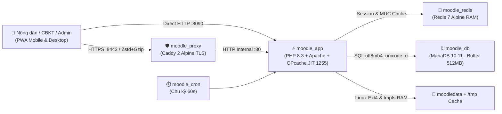

# 🌱 Hệ thống Tập huấn Kỹ thuật Canh tác Nông nghiệp Công nghệ cao — Mầm Xanh LMS 2.0

> **Phiên bản:** `2.0 Production LTS` (Moodle 4.5 LTS · PHP 8.3 OPcache JIT · MariaDB 10.11 · Redis 7 · Caddy 2 TLS/Zstd + Direct HTTP `:8090`)  
> **Định hướng:** Mobile-First (`375x812`) & Desktop (`1440x900`) · Song ngữ Việt–Anh (`🇻🇳 VI | 🇬🇧 EN`) · Video Thực tế HTML5 `<video>` · Xem Trực tiếp PDF Không Cần Tải Về · Gói H5P & SCORM 1.2 Chuẩn Quốc tế · Khóa học Mẫu Tuần tự & 1-Click Course Cloner · Chứng nhận Số QR `HMAC-SHA256` & Truy xuất VietGAP

---

## 1. Tổng quan Kiến trúc Hệ thống (Turbo Docker Architecture)

**Mầm Xanh LMS 2.0** được thiết kế chuyên biệt cho chương trình chuyển đổi số nông nghiệp và đào tạo nông dân thực địa tại các vùng chuyên canh trọng điểm (**Lâm Đồng**, **Đắk Lắk**, **Đồng Nai**). Toàn bộ hệ thống vận hành trên 5 container hiệu năng cao, hỗ trợ song song cả **HTTPS Reverse Proxy (`:8443`)** lẫn **HTTP Trực tiếp Độc lập (`:8090`)** trên `moodle_app`, cô lập hoàn toàn I/O nghẽn cổ chai trên Docker Windows thông qua Linux Named Volumes và `tmpfs` RAM:



### Điểm nhấn Công nghệ & Tối ưu Hiệu năng
1. **Turbo PHP 8.3 & Zero-I/O Bottleneck:**
   - Bật tối đa **OPcache + Tracing JIT (`1255`)** trong `docker/php/zz-performance.ini` (`memory_consumption=256M`, `max_accelerated_files=30000`, `realpath_cache_size=4096K`).
   - Mã nguồn lõi Moodle 4.5 LTS nằm trên phân vùng Linux Ext4 nội bộ container; `$CFG->dataroot` và `$CFG->cachedir` lưu trên Linux Named Volume; `$CFG->localcachedir` và `$CFG->tempdir` chạy trực tiếp trên RAM (`tmpfs` `/tmp`).
   - Lưu trữ toàn bộ **Session** và **Moodle Universal Cache (MUC Application Cache)** trên **Redis 7 Alpine**.
2. **Hệ sinh thái 5 Custom Plugins Nông nghiệp Chuẩn Moodle API:**
   - `local_mamxanhapp`: Trung tâm điều hướng thông minh theo vai trò — Dashboard Nông dân (`/local/mamxanhapp/index.php`), Trung tâm Quản lý & Xuất Báo cáo CSV cho Cán bộ kỹ thuật (`/local/mamxanhapp/manage.php`), **Công cụ Nhân bản Khóa học Mẫu 1-Chạm theo Địa phương (`/local/mamxanhapp/clone_course.php` dùng `\backup_controller` & `\restore_controller`)**, Trung tâm Công cụ Nông nghiệp (`/local/mamxanhapp/calculator.php`), và Trang Kiểm toán Hệ thống Admin (`/local/mamxanhapp/admin_audit.php`).
   - `local_farmerprofile`: Quản lý hồ sơ nông hộ (diện tích $\text{m}^2$, cây trồng chủ lực, vùng trồng Lâm Đồng / Đắk Lắk / Đồng Nai, tọa độ GPS) và tự động đồng bộ vào **System Cohort** theo vùng.
   - `local_agriops`: Quản lý lô sản xuất **VietGAP/GlobalGAP**, ghi nhật ký canh tác rảnh tay bằng giọng nói (**Web Speech API `vi-VN`**) và phát hành mã QR truy xuất nguồn gốc công khai (`/local/agriops/trace.php`).
   - `mod_fieldpractice`: Hoạt động **Thực hành tại vườn** tích hợp mã QR xoay vòng 5 phút + định vị GPS hiện trường + chấm điểm **Rubric 4 tiêu chí (thang 100 điểm)** đồng bộ thẳng vào **Moodle Gradebook** và hỗ trợ sao lưu `.mbz` chuẩn Moodle2.
   - `local_mamxanhcert`: Tự động cấp **Chứng nhận Số PDF & Web** ký mật mã `HMAC-SHA256` kèm Huy hiệu (**Badges**) ngay khi học viên đạt Quiz $\ge 70\%$, hỗ trợ tra cứu công khai qua QR tại `/local/mamxanhcert/verify.php`.
3. **Child Theme `theme_agritrain_child` & 6 Tiện ích Thông minh Thực địa:**
   - **1-Chạm Đăng nhập Tức thì (1-Click Instant Login)** tích hợp CSRF `logintoken` chuẩn xác cho cả 3 vai trò.
   - **Song ngữ 1-chạm `[🇻🇳 VI | 🇬🇧 EN]`** đồng bộ từ Moodle Core, giao diện Custom, Chatbot đến file xuất báo cáo CSV.
   - **PWA (Progressive Web App)** với `manifest.json`, Service Worker `sw.js` và `offline.html` cài đặt ra màn hình chính điện thoại.
   - **Trợ lý Giọng đọc `#mx-tts-player`** tự động đính kèm đầu mỗi bài giảng (hỗ trợ `vi-VN` & `en-US`).
   - **Chế độ Ngoài trời Nắng gắt (`☀️ Ngoài trời`)** siêu tương phản (nền `#FFFFFF`, chữ `#000000`, cỡ chữ `115%`, viền `3px`).
   - **Chatbot nổi "🌱 Bác sĩ Cây trồng 24/7"** & **Trung tâm Công cụ `calculator.php`** (pha phân tưới nhỏ giọt Fertigation, chẩn đoán triệu chứng lá bệnh, cảnh báo thời tiết phun tưới tiểu vùng).

---

## 2. Hướng dẫn Khởi chạy Nhanh (Quick Start)

### Yêu cầu môi trường
- Docker Engine 24+ & Docker Compose v2+ (Windows Docker Desktop WSL2, Linux hoặc macOS).
- Cổng mặc định: `https://moodle.lvh.me:8443` (HTTPS tự động qua Caddy 2; tên miền `moodle.lvh.me` tự phân giải về `127.0.0.1` không cần sửa file `hosts`).

### Khởi động toàn bộ hệ thống
```powershell
# 1. Khởi chạy 5 dịch vụ Docker ở chế độ nền
docker compose up -d --build

# 2. Kiểm tra trạng thái Sẵn sàng (Healthy)
docker compose ps

# 3. Biên dịch CSS và làm sạch Cache (nếu vừa chỉnh sửa giao diện)
docker compose exec -T -u www-data moodle_app php /var/www/html/admin/cli/build_theme_css.php --themes=agritrain_child
docker compose exec -T -u www-data moodle_app php /var/www/html/admin/cli/purge_caches.php
```

Truy cập ngay trên trình duyệt:
- **HTTPS chuẩn Production (qua Caddy 2 Reverse Proxy):** **`https://moodle.lvh.me:8443`** (hoặc `http://localhost:8088`)
- **HTTP Trực tiếp Độc lập vào `moodle_app` (không phụ thuộc Reverse Proxy):** **`http://localhost:8090`**

---

## 3. Tài khoản Phân quyền 3 Cấp (Dùng ngay hoặc bấm 1-Chạm trên trang Đăng nhập)

| Cấp phân quyền | Tên đăng nhập | Mật khẩu | Vai trò & Trang đích tự động sau đăng nhập |
| :--- | :--- | :--- | :--- |
| **1. Quản trị viên Hệ thống** | `admin` | `Admin!2026MX` | Toàn quyền quản trị hạ tầng, plugins, bảo mật & kiểm toán (`/local/mamxanhapp/manage.php` & `/local/mamxanhapp/admin_audit.php`) |
| **2. Cán bộ Kỹ thuật (CBKT)** | `cbkt_pilot` | `MX!Canbo2026` | Role `canbokythuat`: Biên soạn khóa học, chấm Rubric thực hành vườn, thống kê vùng trồng & xuất CSV (`/local/mamxanhapp/manage.php`) |
| **3. Nông dân Lâm Đồng** | `nd_rau_lamdong` | `MX!Rau2026` | Học viên vùng rau/hoa nhà màng Đà Lạt — vào thẳng Dashboard Nông dân (`/local/mamxanhapp/index.php`) |
| **3. Nông dân Đắk Lắk** | `nd_saurieng_daklak` | `MX!Rau2026` | Học viên vùng Sầu riêng xuất khẩu Krông Pắc (`/local/mamxanhapp/index.php`) |
| **3. Nông dân Đồng Nai** | `nd_vanan` | `MX!Rau2026` | Học viên vùng Trái cây VietGAP Long Khánh (`/local/mamxanhapp/index.php`) |

*(Hệ thống còn tích hợp sẵn 12 tài khoản nông dân mô phỏng khác thuộc 3 vùng trồng với cùng mật khẩu `MX!Rau2026` để phục vụ kiểm thử biểu đồ và báo cáo).*

---

## 4. Danh mục Khóa học Mẫu Chuẩn & 6 Khóa học Nông nghiệp Công nghệ cao

| Mã khóa | Tên khóa học | Nội dung số hóa (Video HTML5, PDF Embed, H5P, SCORM 1.2, Thực hành Vườn & Quiz) |
| :--- | :--- | :--- |
| **`MASTER-AGRITECH-TPL`** *(Mẫu Chuẩn)* | **[MẪU CHUẨN] Khung Chương trình Tập huấn Nông nghiệp Công nghệ cao (Master Template)** | **Lộ trình tuần tự 4 bước (Restrict Access):** Bước 1 (Video MP4 + Xem trực tiếp PDF) → Bước 2 (H5P Question Set + SCORM 1.2) → Bước 3 (Thực hành vườn QR/GPS + Rubric) → Bước 4 (Quiz 12 câu $\ge 70\%$ mở Chứng nhận Số QR). Nhân bản 1-Chạm tại `/local/mamxanhapp/clone_course.php` |
| **`CHAMSOC01`** *(Cốt lõi)* | Kỹ thuật Chăm sóc Cây trồng Công nghệ cao & Tưới Tiết kiệm | Video MP4 thực tế + Phụ đề `.vtt`, **Sổ tay PDF nhúng trực tiếp (`650px`/`480px` + Zoom)**, **H5P Question Set & H5P Accordion**, **SCORM 1.2 VietGAP**, Slide Deck 7 trang, Thẻ lật IPM, Thực hành vườn & Quiz 12 câu |
| **`CHEBIEN01`** *(Cốt lõi)* | Công nghệ Sơ chế, Chế biến Sâu & Bảo quản Nông sản Sau Thu hoạch | Video MP4 thực tế Pre-cooling + Phụ đề `.vtt`, **Quy trình PDF nhúng trực tiếp**, **H5P Course Presentation**, **SCORM 1.2 VietGAP**, Slide Deck 7 trang sấy lạnh & MAP/CA, Thẻ lật QR VietGAP, Thực hành vườn & Quiz 12 câu |
| **`IOTNHAMANG01`** | Vận hành Nhà màng Thông minh & Cảm biến Nông nghiệp IoT | Video MP4 thực tế nhà màng + Phụ đề `.vtt`, điều khiển vi khí hậu VPD, cảm biến bức xạ/độ ẩm giá thể, tự động hóa rèm cắt nắng & Quiz 12 câu |
| **`THUYCANH01`** | Kỹ thuật Thủy canh Hồi lưu NFT & Kiểm soát Dinh dưỡng A-B | Video MP4 thực tế thủy canh + Phụ đề `.vtt`, pha dung dịch mẹ A-B tránh kết tủa Ca–P/S, kiểm soát oxy hòa tan DO, nhiệt độ bồn rễ & Quiz 12 câu |
| **`SAURIENG01`** | Quy trình Canh tác Sầu riêng Xuất khẩu Chuẩn Mã số Vùng trồng | Video MP4 thực tế tưới nhỏ giọt + Phụ đề `.vtt`, tạo cơi đọt, xiết nước phân hóa mầm hoa, quản lý *Phytophthora* & hồ sơ mã vùng xuất khẩu |
| **`PHANVISINH01`** | Sản xuất Phân Hữu cơ Vi sinh Tuần hoàn & Nấm đối kháng *Trichoderma* | Video MP4 thực tế ủ phân vi sinh + Phụ đề `.vtt`, nhân sinh khối *Trichoderma* & IMO bản địa, ủ nhiệt hiếu khí C/N 25–30:1 & Quiz 12 câu |

---

## 5. Cấu trúc Thư mục Dự án

```text
Moodle 4.0/
├── Dockerfile                        # Image PHP 8.3-apache + Moodle 4.5 LTS + 10 PHP Extensions + Git
├── docker-compose.yml                # Kiến trúc 5 dịch vụ: app, db, redis, proxy (Caddy 2), cron
├── .env / .env.example               # Cấu hình biến môi trường, cổng mạng & khóa ký số HMAC
├── docker/
│   ├── apache/moodle.conf            # Cấu hình VirtualHost & nén/headers Apache
│   ├── caddy/Caddyfile               # Reverse Proxy HTTPS nội bộ (moodle.lvh.me:8443) + nén Zstd/Gzip
│   ├── php/zz-performance.ini        # Cấu hình OPcache 256MB + JIT 1255 + Realpath Cache 4096K
│   └── entrypoint.sh                 # Khởi tạo thư mục RAM /tmp & phân quyền tự động
├── moodle_custom/
│   ├── config.php                    # Tách I/O sang Linux Volume + tmpfs RAM + Redis Session
│   ├── pwa/                          # manifest.json, sw.js, offline.html & bộ icon PWA 192/512px
│   ├── theme/agritrain_child/        # Giao diện Mobile-First, 1-Click Login, TTS, Ngoài trời, Chatbot 24/7
│   ├── local/mamxanhapp/             # Dashboard Nông dân, Quản lý CBKT, Xuất CSV BOM, Máy tính Nông vụ
│   ├── local/farmerprofile/          # Hồ sơ nông hộ & đồng bộ tự động Cohort 3 vùng trồng
│   ├── local/agriops/                # Lô nông sản VietGAP, Nhật ký giọng nói Web Speech & QR Traceability
│   ├── local/mamxanhcert/            # Chứng nhận số PDF/Web HMAC-SHA256 & Cổng xác thực QR công khai
│   └── mod/fieldpractice/            # Activity Thực hành vườn QR xoay vòng + GPS + Rubric 4 tiêu chí Gradebook
├── scripts/
│   ├── cli/                          # Bộ kịch bản CLI cài đặt hệ thống, phân quyền, khóa học & dữ liệu mẫu
│   └── backup/                       # Công cụ sao lưu & phục hồi tự động (.ps1 & .sh cho SQL và .mbz)
├── backups/                          # Lưu trữ bản sao lưu thực tế (.sql & gói khóa học .mbz)
├── tests/e2e/                        # Kiểm thử tự động Puppeteer E2E đa vai trò & đo Benchmark TTFB
└── docs/                             # Bộ tài liệu hướng dẫn Triển khai, Biên soạn & Cẩm nang Nông dân
```

---

## 6. Bộ Tài liệu Hướng dẫn Chi tiết
- 🗺️ [Sơ đồ Nghiệp vụ Toàn diện & Hướng dẫn Thực hiện 18 Chức năng Hệ thống](docs/BUSINESS_WORKFLOWS_AND_USER_MANUAL.md)
- 📘 [Hướng dẫn Cài đặt, Phân quyền & Sao lưu dành cho Quản trị viên](docs/ADMIN_DEPLOYMENT_GUIDE.md)
- 📗 [Hướng dẫn Biên soạn Khóa học Tương tác & Chấm điểm Thực hành cho Cán bộ Kỹ thuật](docs/INSTRUCTOR_AUTHORING_GUIDE.md)
- 📙 [Cẩm nang 6 Bước Học tập & Ghi Nhật ký Nông vụ trên Điện thoại dành cho Nông dân](docs/FARMER_USER_GUIDE.md)
