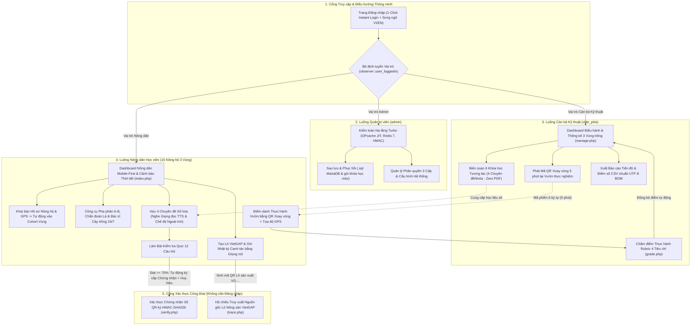
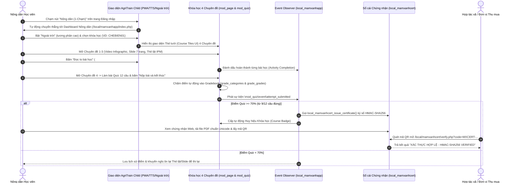
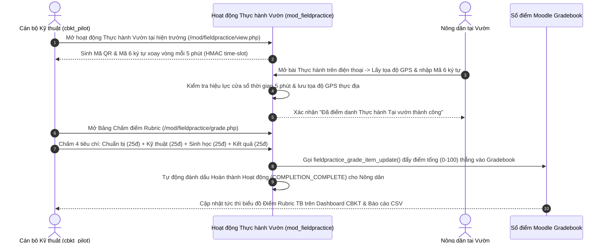
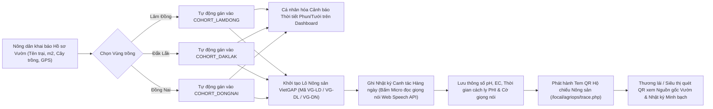
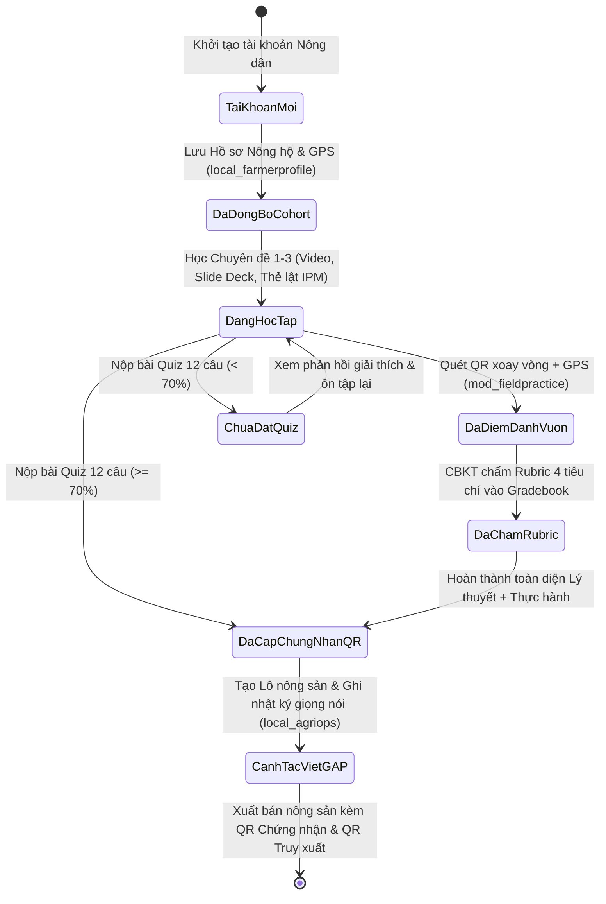

# 🗺️ Sơ đồ Nghiệp vụ & Hướng dẫn Thực hiện Toàn bộ Chức năng — Mầm Xanh LMS 2.0

Tài liệu này mô hình hóa **5 sơ đồ nghiệp vụ cốt lõi** và hướng dẫn thao tác từng bước cho **18 chức năng thực tế** của hệ thống **Mầm Xanh LMS 2.0** (`https://moodle.lvh.me:8443`).

---

## PHẦN I: HỆ THỐNG SƠ ĐỒ NGHIỆP VỤ (BUSINESS PROCESS DIAGRAMS)

### 1. Sơ đồ Tổng thể Hệ sinh thái Nghiệp vụ Liên thông 4 Tác nhân

---

### 2. Sơ đồ Tuần tự: Luồng Học tập Số hóa, Thi Quiz & Tự động Cấp Chứng nhận QR `HMAC-SHA256`

---

### 3. Sơ đồ Tuần tự: Luồng Điểm danh Thực hành Vườn (QR Xoay vòng + GPS) & Chấm Rubric 4 Tiêu chí

---

### 4. Sơ đồ Luồng Hồ sơ Nông hộ, Phân nhóm Cohort Tự động & Truy xuất Nguồn gốc VietGAP

---

### 5. Sơ đồ Vòng đời Trạng thái Học viên

---

## PHẦN II: HƯỚNG DẪN THỰC HIỆN CHI TIẾT 18 CHỨC NĂNG

### Tài khoản Thực hành Nhanh
- **Cổng truy cập:** `https://moodle.lvh.me:8443` *(hoặc `http://localhost:8088`)*
- **Nông dân:** `nd_rau_lamdong` / `MX!Rau2026` *(hoặc `nd_saurieng_daklak`, `nd_vanan`)*
- **Cán bộ kỹ thuật:** `cbkt_pilot` / `MX!Canbo2026`
- **Quản trị viên:** `admin` / `Admin!2026MX`

### Nhóm A — Chức năng Chung & 6 Tiện ích Thông minh Thực địa
1. **Đăng nhập 1-Chạm & Điều hướng Tự động (`/login/index.php`):** Chạm một trong 3 nút vai trò trong khung *"⚡ 1-Chạm Đăng nhập Tức thì"* để tự động gắn CSRF `logintoken` và chuyển thẳng tới Dashboard tương ứng.
2. **Song ngữ 1-Chạm `[🇻🇳 VI | 🇬🇧 EN]`:** Chạm nút `🇬🇧 EN` hoặc `🇻🇳 VI` trên thanh tiện ích đầu trang để chuyển ngôn ngữ tức thì cho toàn bộ giao diện, Chatbot và file xuất CSV.
3. **Chế độ Ngoài trời Nắng gắt (`☀️ Ngoài trời`):** Bấm nút `☀️ Ngoài trời` trên thanh tiện ích để kích hoạt giao diện nền trắng `#FFFFFF`, chữ đen `#000000` cỡ `115%`, viền đậm `3px`.
4. **Trợ lý Giọng đọc Bài giảng (`#mx-tts-player`):** Mở bài học bất kỳ -> Bấm `▶️ Đọc to bài học`, chọn tốc độ `0.85x / 1.0x / 1.15x` để nghe rảnh tay bằng giọng đọc Tiếng Việt / Tiếng Anh.
5. **Chatbot nổi `"🌱 Bác sĩ Cây trồng 24/7"`:** Bấm nút nổi góc dưới phải -> Chạm chip câu hỏi nhanh (`pH / EC`, `Sâu bệnh IPM`, `Nấm Trichoderma`, `Kho lạnh`) hoặc nhập triệu chứng để nhận phác đồ sinh học.
6. **Cài đặt PWA ra Màn hình Chính:** Trên Chrome/Safari điện thoại, chọn *"Thêm vào màn hình chính"* để sử dụng như ứng dụng độc lập có hỗ trợ trang `offline.html` khi mất mạng.

### Nhóm B — Chức năng Dành cho Nông dân Học viên
7. **Hồ sơ Nông hộ & Đồng bộ Cohort (`/local/farmerprofile/index.php`):** Khai báo tên nông hộ, diện tích ($\text{m}^2$), cây trồng chính, vùng trồng (`Lâm Đồng / Đắk Lắk / Đồng Nai`) và tọa độ GPS -> Tự động đồng bộ vào Cohort vùng trồng.
8. **Trung tâm Công cụ Nông vụ (`/local/mamxanhapp/calculator.php`):** Chuyển đổi 3 tab để tính công thức pha phân tưới nhỏ giọt A–B, chẩn đoán triệu chứng lá bệnh IPM và xem cảnh báo thời tiết phun tưới tiểu vùng.
9. **Học 4 Chuyên đề Số hóa trên Thẻ lưới (`/course/view.php?id=2..7`):** Bấm `🚀 Vào học ngay` để học Video + Infographic HTML5, lật Slide tương tác 7 trang (kèm câu hỏi tình huống) và lật Thẻ Flashcards IPM.
10. **Điểm danh Thực hành Vườn QR + GPS (`/mod/fieldpractice/view.php`):** Nhập mã phiên 6 ký tự xoay vòng 5 phút từ màn hình CBKT kèm tọa độ GPS hiện trường -> Bấm `📍 Xác nhận Điểm danh Tại Vườn`.
11. **Làm bài Quiz 12 câu & Nhận Chứng nhận QR (`/mod/quiz/view.php` -> `/local/mamxanhcert/index.php`):** Đạt $\ge 70\%$ để mở khóa tự động Huy hiệu & Chứng nhận ký số `HMAC-SHA256`, tải file PDF tiếng Việt và lấy mã QR.
12. **Quản lý Lô VietGAP & Nhật ký Giọng nói (`/local/agriops/index.php`):** Đăng ký lô sản xuất mới để nhận mã `VG-...`, sau đó bấm `🎙️ Bấm để Đọc bằng Giọng nói` (Web Speech API) để ghi nhật ký pH, EC, PHI vào sổ điện tử.

### Nhóm C — Chức năng Dành cho Cán bộ Kỹ thuật (`cbkt_pilot`)
13. **Giám sát Dashboard Vùng trồng & Xuất CSV (`/local/mamxanhapp/manage.php`):** Xem KPI 3 vùng trồng, lọc danh sách nông dân theo từng tỉnh và bấm `📥 Xuất Báo cáo Excel (CSV UTF-8)` chuẩn UTF-8 BOM.
14. **Chấm điểm Thực hành Vườn Rubric 4 Tiêu chí (`/mod/fieldpractice/grade.php`):** Nhập điểm 4 tiêu chí (mỗi tiêu chí 0–25 điểm) + nhận xét -> Bấm `💾 Lưu điểm` để đẩy thẳng điểm tổng 100 vào Sổ điểm Moodle Gradebook.
15. **Biên soạn Học liệu Tương tác Mới:** Bật công tắc `Chế độ chỉnh sửa` trên thanh đầu trang khóa học để thêm hoạt động `Page`, `Thực hành tại vườn` hoặc `Quiz`.

### Nhóm D — Chức năng Quản trị (`admin`) & Tra cứu Công khai
16. **Kiểm toán Hiệu năng & Bảo mật (`/local/mamxanhapp/admin_audit.php`):** Chỉ dành riêng cho `admin` (chặn `403` với vai trò khác) để giám sát OPcache JIT, Redis 7, MariaDB 10.11 và chữ ký `HMAC-SHA256`.
17. **Sao lưu & Phục hồi Hệ thống (`scripts/backup/`):** Chạy `backup.ps1` / `backup.sh` để xuất `.sql` và gói khóa học `.mbz`; chạy `restore.ps1` / `restore.sh` để khôi phục nhanh.
18. **Xác thực QR Công khai Không cần Đăng nhập:**
    - Tra cứu Chứng nhận số QR: `/local/mamxanhcert/verify.php?code=MXCERT-2026-CHEBIEN01-0043`
    - Tra cứu Hộ chiếu Lô nông sản VietGAP: `/local/agriops/trace.php?code=VG-LD-202611-0016`
